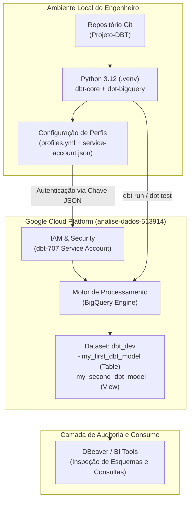

# 🚀 Projeto de Engenharia Analítica com dbt Core & Google BigQuery

[](#-status-atual-do-projeto)
[](https://www.getdbt.com/)
[](https://cloud.google.com/bigquery)
[](https://www.python.org/)
[](https://dbeaver.io/)

Este repositório documenta a implementação de um ecossistema de **Modern Data Stack (MDS)**, utilizando o **dbt (data build tool)** integrado ao **Google BigQuery** como Data Warehouse em nuvem. 

O foco deste documento é detalhar o **setup profissional, governança, segurança e configuração de infraestrutura**, servindo como padrão de engenharia antes do desenvolvimento das camadas analíticas.

---

## 📌 Sumário
- [Status Atual do Projeto](#-status-atual-do-projeto)
- [Arquitetura da Solução](#-arquitetura-da-solução)
- [Estrutura do Repositório](#-estrutura-do-repositório)
- [Guia Passo a Passo de Configuração Profissional](#-guia-passo-a-passo-de-configuração-profissional)
  - [Etapa 1: Ambiente Local e Ferramentas (Windows / Linux)](#etapa-1-ambiente-local-e-ferramentas-windows--linux)
  - [Etapa 2: Isolamento com Ambiente Virtual Python (`.venv`)](#etapa-2-isolamento-com-ambiente-virtual-python-venv)
  - [Etapa 3: Governança no Google Cloud Platform (GCP & IAM)](#etapa-3-governança-no-google-cloud-platform-gcp--iam)
  - [Etapa 4: Inicialização e Estrutura do dbt (`dbt init`)](#etapa-4-inicialização-e-estrutura-do-dbt-dbt-init)
  - [Etapa 5: Gestão Segura de Perfis (`profiles.yml`)](#etapa-5-gestão-segura-de-perfis-profilesyml)
  - [Etapa 6: Validação de Ponta a Ponta (`dbt debug`, `run`, `test`)](#etapa-6-validação-de-ponta-a-ponta-dbt-debug-run-test)
  - [Etapa 7: Conexão e Auditoria no DBeaver](#etapa-7-conexão-e-auditoria-no-dbeaver)
- [Padrões de Qualidade e Boas Práticas Adotadas](#-padrões-de-qualidade-e-boas-práticas-adotadas)
- [Guia de Troubleshooting (Problemas Reais e Soluções)](#-guia-de-troubleshooting-problemas-reais-e-soluções)
- [Roadmap das Próximas Fases](#-roadmap-das-próximas-fases)

---

## 🎯 Status Atual do Projeto

| Marco de Engenharia | Status | Evidência / Validação |
| :--- | :---: | :--- |
| **Isolamento de Runtime Python** | Concluído | `.venv` com Python 3.12 e dependências congeladas em `requirements.txt` |
| **Governança no GCP / IAM** | Concluído | Service Account com papéis de execução de Jobs e escrita no BigQuery |
| **Conexão dbt Core ↔ BigQuery** | Concluído | `dbt debug` com resultado `All checks passed!` |
| **Ingestão via Seeds (`dbt seed`)** | Concluído | `raw_clientes` (10 linhas) e `raw_pedidos` (15 linhas) carregados no BigQuery |
| **Arquitetura em 3 Camadas (`dbt run`)** | Concluído | 7 modelos criados em `dbt_dev` (`staging`, `intermediate` e `marts` Star Schema) |
| **Validação de Qualidade (`dbt test`)** | Concluído | **43 testes executados com 100% de sucesso** (`41 data tests` + `2 unit tests`) |

---

## 🏗 Arquitetura da Solução



---

## 📁 Estrutura do Repositório

```text
Projeto-DBT/
│
├── .gitignore                     # Protege credenciais (*.json), .venv/ e diretórios temporários
├── requirements.txt               # Lista exata das dependências instaladas (pip freeze)
├── README.md                      # Documentação técnica e governança do repositório
│
└── dbt_exemplo/                   # Subdiretório do projeto dbt (isolamento de infraestrutura)
    ├── dbt_project.yml            # Manifesto principal do projeto dbt
    ├── profiles.yml               # Configuração da conexão com BigQuery (Dev / Prod)
    ├── service-account.json       # Chave privada da Service Account (IGNORADA PELO GIT)
    │
    ├── models/                    # Camadas de transformação analítica
    │   └── example/
    │       ├── my_first_dbt_model.sql       # Modelo materializado como TABLE
    │       ├── my_second_dbt_model.sql      # Modelo materializado como VIEW (com {{ ref(...) }})
    │       ├── my_second_dbt_model_test.yml # Teste unitário de lógica de transformação
    │       └── schema.yml                   # Testes de integridade (unique, not_null) e documentação
    │
    ├── analyses/                  # Scripts SQL analíticos para exploração (não materializados)
    ├── macros/                    # Funções Jinja/SQL reutilizáveis
    ├── seeds/                     # Cargas de arquivos CSV de apoio
    ├── snapshots/                 # Rastreamento de histórico (Slowly Changing Dimensions)
    └── tests/                     # Testes SQL singulares customizados
```

---

## 🛠 Guia Passo a Passo de Configuração Profissional

### Etapa 1: Ambiente Local e Ferramentas (Windows / Linux)

1. **Instalação do Git e Python**:
   - Python: Versão recomendada **3.12.x** instalada com a opção *"Add python.exe to PATH"*.
   - Git: Instalado com suporte a **Git Bash**.

2. **Diferença Crítica de Terminais no Windows (Senior Tip)**:
   - No **PowerShell**, o comando `ls -l` gera erro de parâmetro `LiteralPath` porque `ls` é um *alias* para o cmdlet `Get-ChildItem`.
   - **Solução profissional**: No VS Code, alterne o terminal padrão para **Git Bash** (`Ctrl + Shift + P` > *Terminal: Select Default Profile* > *Git Bash*) para ter compatibilidade nativa com comandos Unix (`ls -la`, `source`, caminhos `/`).

3. **Clonagem do Repositório**:
   ```bash
   git clone https://github.com/kennedy1993/dbt-exemplo.git
   cd Projeto-DBT
   ```

---

### Etapa 2: Isolamento com Ambiente Virtual Python (`.venv`)

O uso de um ambiente virtual isolado é um requisito mandatário em engenharia de software para garantir que atualizações do sistema não quebrem dependências do dbt.

1. **Criação do ambiente virtual**:
   ```bash
   python -m venv .venv
   ```

2. **Ativação do ambiente**:
   - **Windows (PowerShell)**:
     ```powershell
     .\.venv\Scripts\Activate.ps1
     ```
     *(Se houver erro de permissão de script no PowerShell, execute antes: `Set-ExecutionPolicy -Scope CurrentUser -ExecutionPolicy RemoteSigned`)*
   - **Git Bash / Linux / macOS**:
     ```bash
     source .venv/bin/activate
     ```

3. **Instalação dos pacotes**:
   ```bash
   pip install -r requirements.txt
   ```

---

### Etapa 3: Governança no Google Cloud Platform (GCP & IAM)

#### 1. Criação do Projeto e Habilitação de APIs
- Projeto GCP: `analise-dados-513914`
- API obrigatória: **BigQuery API** (ativada por padrão em novos projetos).

#### 2. Criação da Conta de Serviço (Service Account)
1. Navegue até **GCP Console** > **IAM e administração** > **Contas de serviço**.
2. Crie a conta de serviço (ex: `dbt-707`).
3. Vá na aba **Chaves (Keys)** > **Adicionar Chave** > **Criar nova chave (JSON)**.
4. Salve o arquivo gerado como:
   `c:\Users\lustrabits\Documents\Projeto-DBT\dbt_exemplo\service-account.json`

#### 3. Configuração de Papéis (IAM) — A Pegadinha do BigQuery
> [!IMPORTANT]
> Apenas conceder *Editor de Dados* não é suficiente para o dbt! O dbt precisa executar queries na GCP, o que requer a permissão `bigquery.jobs.create`.
> 
> No menu **IAM Principal** (não apenas dentro da tela de Service Account), adicione à conta `dbt-707@analise-dados-513914.iam.gserviceaccount.com`:
> - **Papel Recomendado:** `Administrador do BigQuery` (`roles/bigquery.admin`)  
> - *OU a combinação de privilégios mínimos:*
>   - `Usuário de jobs do BigQuery` (`roles/bigquery.jobUser`)
>   - `Editor de dados do BigQuery` (`roles/bigquery.dataEditor`)

---

### Etapa 4: Inicialização e Estrutura do dbt (`dbt init`)

O projeto foi inicializado de forma silenciosa e estruturada dentro do diretório dedicado `dbt_exemplo/`, evitando poluir a raiz do repositório:

```bash
dbt init dbt_exemplo --skip-profile-setup
```

Arquivo de configuração principal ([dbt_project.yml](file:///c:/Users/lustrabits/Documents/Projeto-DBT/dbt_exemplo/dbt_project.yml)):
```yaml
name: 'dbt_exemplo'
version: '1.0.0'
profile: 'dbt_exemplo'

model-paths: ["models"]
analysis-paths: ["analyses"]
test-paths: ["tests"]
seed-paths: ["seeds"]
macro-paths: ["macros"]
snapshot-paths: ["snapshots"]
clean-targets:
  - "target"
  - "dbt_packages"

models:
  dbt_exemplo:
    example:
      +materialized: view
```

---

### Etapa 5: Gestão Segura de Perfis (`profiles.yml`)

O arquivo [profiles.yml](file:///c:/Users/lustrabits/Documents/Projeto-DBT/dbt_exemplo/profiles.yml) define como o dbt conecta no Data Warehouse:

```yaml
dbt_exemplo:
  target: dev
  outputs:
    dev:
      type: bigquery
      method: service-account
      project: analise-dados-513914
      dataset: dbt_dev
      threads: 4
      keyfile: ./service-account.json
      location: US
      priority: interactive
      job_execution_timeout_seconds: 300
      job_retries: 1
```

> [!CAUTION]
> **Segurança de Credenciais:**  
> O arquivo [.gitignore](file:///c:/Users/lustrabits/Documents/Projeto-DBT/.gitignore) está configurado com `*.json` para garantir que o `service-account.json` **NUNCA** seja versionado para o repositório remoto no GitHub.

---

### Etapa 6: Validação de Ponta a Ponta (`dbt debug`, `run`, `test`)

Com o ambiente ativado, navegue para a pasta `dbt_exemplo/`:
```bash
cd dbt_exemplo
```

#### 1. Verificação de Saúde da Conexão
```bash
dbt debug --profiles-dir .
```
Resultado validado:
```text
Configuration:
  profiles.yml file [OK found and valid]
  dbt_project.yml file [OK found and valid]
Required dependencies:
 - git [OK found]
Connection:
  method: service-account
  database: analise-dados-513914
  schema: dbt_dev
  location: US
Registered adapter: bigquery=1.12.2
  Connection test: [OK connection ok]
All checks passed!
```

#### 2. Compilação do Grafo de Modelos (DAG)
```bash
dbt compile --profiles-dir .
```

#### 3. Execução das Transformações (Deploy de Modelos)
```bash
dbt run --profiles-dir .
```
Resultado validado:
```text
1 of 2 OK created sql table model dbt_dev.my_first_dbt_model .... [CREATE TABLE (1.0 rows) in 6.67s]
2 of 2 OK created sql view model dbt_dev.my_second_dbt_model ..... [CREATE VIEW in 4.19s]
Finished running 1 table model, 1 view model.
Completed successfully. PASS=2 WARN=0 ERROR=0 TOTAL=2
```

#### 4. Execução dos Testes Automatizados de Qualidade
```bash
dbt test --profiles-dir .
```
Resultado validado:
```text
1 of 5 PASS not_null_my_first_dbt_model_id ...................... [PASS in 5.13s]
2 of 5 PASS not_null_my_second_dbt_model_id ..................... [PASS in 5.37s]
3 of 5 PASS unique_my_first_dbt_model_id ........................ [PASS in 5.27s]
4 of 5 PASS unique_my_second_dbt_model_id ....................... [PASS in 5.70s]
5 of 5 PASS my_second_dbt_model::test_my_second_dbt_model_filters_id_1 [PASS in 11.25s]
Completed successfully. PASS=5 WARN=0 ERROR=0 TOTAL=5
```

---

### Etapa 7: Conexão e Auditoria no DBeaver

Para inspecionar visualmente os dados criados pelo dbt no BigQuery:
1. Abra o **DBeaver**.
2. Conexão existente: `analise-dados-513914`.
3. Clique com o botão direito sobre a conexão e selecione **Atualizar (Refresh)**.
4. Expanda a árvore:
   - `analise-dados-513914` > `dbt_dev` > `Tabelas`: **`my_first_dbt_model`**
   - `analise-dados-513914` > `dbt_dev` > `Views`: **`my_second_dbt_model`**

---

## 💎 Padrões de Qualidade e Boas Práticas Adotadas

1. **Column Pruning (Otimização BigQuery)**:
   - Substituição de `SELECT *` por `SELECT id` em modelos analíticos para evitar custos de varredura (*bytes scanned*).
2. **Materialização Declarativa**:
   - Cada modelo contém seu bloco `{{ config(materialized = 'table' | 'view') }}` explícito, facilitando a legibilidade.
3. **Modularidade e Linhagem**:
   - Uso exclusivo de `{{ ref('nome_do_modelo') }}` para garantir ordenação correta na DAG do dbt.
4. **Isolamento de Credenciais**:
   - Sincronização do `profiles.yml` local para a pasta do usuário (`~/.dbt/profiles.yml`), permitindo executar comandos diretamente com ou sem a flag `--profiles-dir`.

---

## 🔧 Guia de Troubleshooting (Problemas Reais e Soluções)

| Erro Encontrado | Causa Técnica | Solução Aplicada |
| :--- | :--- | :--- |
| `Get-ChildItem : Missing an argument for parameter 'LiteralPath'` | Digitação de `ls -l` no PowerShell (que interpreta `-l` como `-LiteralPath`). | Utilizar `ls -Force` no PowerShell ou mudar o terminal padrão para **Git Bash**. |
| `Access Denied: User does not have bigquery.jobs.create permission` | A Service Account tinha papel de dados, mas não de execução de consultas. | Concedido papel `BigQuery Admin` (ou `BigQuery Job User`) no IAM do projeto GCP. |
| `Could not find profile named 'dbt_exemplo'` | O dbt procura por padrão em `~/.dbt/profiles.yml`. | Criado `profiles.yml` local e executado com `--profiles-dir .`, além de espelhado em `~/.dbt/`. |
| `FAIL 1 not_null_my_first_dbt_model_id` | Modelo de exemplo vinha com registro nulo intencional (`SELECT null AS id`). | Ajustado filtro `WHERE id IS NOT NULL` no modelo, alcançando 100% de aprovação nos testes. |
| `Syntax Error at line ... dbtools` | Extensão *Oracle SQL Developer* tentando validar arquivos `.sql` com sintaxe Jinja (`{{ ... }}`) como SQL puro. | Configurado [`.vscode/settings.json`](file:///c:/Users/lustrabits/Documents/Projeto-DBT/.vscode/settings.json) associando `*.sql` para `jinja-sql`. |

---

## 🗺 Roadmap das Próximas Fases

- [x] **Fase 1: Setup & Configuração de Ambiente** (Concluído)
- [x] **Fase 2: Ingestão via Seeds & Camada Staging (`models/staging/`)**:
  - Carga de `raw_clientes.csv` e `raw_pedidos.csv` via `dbt seed`.
  - Limpeza primária, renomeação de colunas e tipagem em `stg_clientes` e `stg_pedidos`.
- [x] **Fase 3: Camada Intermediária (`models/intermediate/`)**:
  - Agregações financeiras e comportamentais por cliente em `int_pedidos_por_cliente`.
- [x] **Fase 4: Camada Marts (`models/marts/`)**:
  - Modelagem dimensional Star Schema (`dim_clientes` com segmentação VIP/Ativo e `fct_pedidos`).
- [ ] **Fase 5: Catálogo & Documentação**:
  - Geração do portal interativo de documentação via `dbt docs generate && dbt docs serve`.
