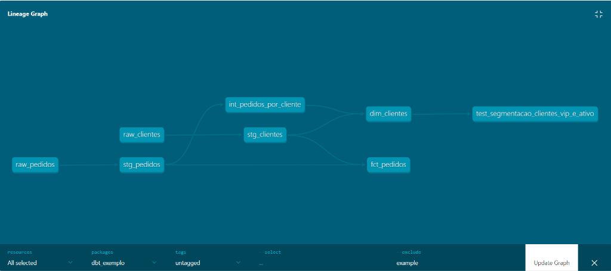

# 📦 Módulo dbt Core: `dbt_exemplo` (Google BigQuery)

Este diretório contém o projeto **dbt Core** conectado ao **Google BigQuery** (`analise-dados-513914.dbt_dev`), estruturado em **3 camadas analíticas (Staging, Intermediate e Marts - Star Schema)**.

> 📖 **Documentação Completa:** Para o guia passo a passo de configuração de infraestrutura, IAM, `.venv` e Troubleshooting, consulte o [README principal na raiz do repositório](../README.md).

---

## 🌐 Grafo de Linhagem (dbt Docs Lineage Graph - DAG)



---

## 🚀 Comandos Rápidos de Execução

Certifique-se de estar dentro desta pasta (`dbt_exemplo/`) e com o ambiente virtual `.venv` ativo:

```bash
# 1. Testar a conexão com o BigQuery
dbt debug --profiles-dir .

# 2. Carregar os arquivos CSV brutos (Seeds) para o BigQuery
dbt seed --profiles-dir .

# 3. Executar todos os modelos das camadas Staging, Intermediate e Marts
dbt run --profiles-dir .

# 4. Executar os 45 testes de integridade + 2 testes unitários
dbt test --profiles-dir .

# 5. Gerar e abrir o Portal de Documentação e Linhagem na porta 8085
dbt docs generate --profiles-dir .
dbt docs serve --profiles-dir . --port 8085
```

---

## 📊 Camadas do Pipeline

| Camada | Materialização | Modelos | Descrição |
| :--- | :---: | :--- | :--- |
| **Seeds (`seeds/`)** | `Table (CSV)` | `raw_clientes`, `raw_pedidos` | Dados brutos transacionais simulados via CSV. |
| **Staging (`models/staging/`)** | `View` | `stg_clientes`, `stg_pedidos` | Higienização (`TRIM`, `LOWER`, `UPPER`) e tipagem defensiva (`SAFE_CAST`). |
| **Intermediate (`models/intermediate/`)** | `View` | `int_pedidos_por_cliente` | Consolidação de métricas financeiras e comportamentais por cliente. |
| **Marts (`models/marts/`)** | `Table` | `dim_clientes`, `fct_pedidos` | Modelagem dimensional **Star Schema** pronta para consumo em BI e DBeaver. |
